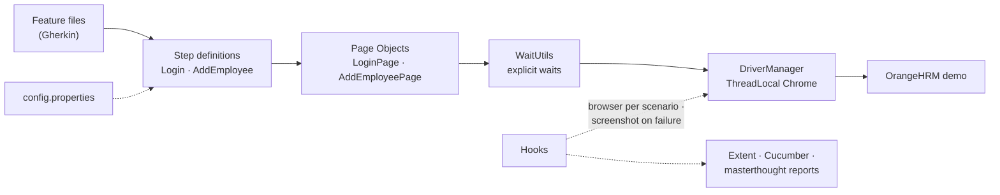

<div align="center">

# 👥 OrangeHRM BDD Automation

### Cucumber + Selenium suite for the OrangeHRM demo — login, logout, PIM › Add Employee

[](https://git.io/typing-svg)

<!-- ============ STATUS BAR ============ -->
[](https://github.com/rbchy/OrangeHRM_Automation/actions/workflows/tests.yml)
-22c55e?style=for-the-badge&logo=checkmarx&logoColor=white)


</div>

---

## 📌 At a Glance

<table>
<tr>
<td width="50%" valign="top">

**🙋 What this is**

A BDD suite for **[OrangeHRM](https://opensource-demo.orangehrmlive.com/)**, the open-source HR management system, run against its public demo. Plain-English Gherkin drives Page Objects through Selenium: authentication (valid login, wrong password, logout) and **PIM › Add Employee** — including checking that the saved employee's profile really opens, and that a missing required field blocks the save.

Every push runs the suite in **GitHub Actions** with headless Chrome and keeps three reports.

> *A test that cannot fail is not a test — every step here asserts something on the real page.*

</td>
<td width="50%" valign="top">

**📍 Quick facts**

| | |
|---|---|
| 🧪 **Scenarios** | 5 in 2 feature files |
| ✅ **CI** | 5 / 5 · headless Chrome · ≈ 40 s |
| 🏷️ **Tags** | `@smoke` · `@regression` · `@Login` · `@PIM` · `@negative` |
| 📊 **Reports** | Extent · Cucumber HTML · masterthought |
| 📸 **On failure** | Screenshot in Extent and Cucumber |

</td>
</tr>
</table>

---

## ✅ Latest Results

| Feature | Scenario | Tags | Result |
|---|---|---|---|
| 🔐 Login | Valid login opens the dashboard | `@smoke @regression` |  |
| 🔐 Login | Invalid password shows *"Invalid credentials"* | `@regression @negative` |  |
| 🔐 Login | Logout returns to the login page | `@smoke @regression` |  |
| 👤 PIM | Add a new employee → their Personal Details page opens with the right name | `@smoke @regression` |  |
| 👤 PIM | Missing last name → *"Required"* and nothing is saved | `@regression @negative` |  |

<sub>GitHub Actions, Ubuntu, Temurin 17, headless Chrome ([workflow](.github/workflows/tests.yml)). Each new employee gets a unique last name, so runs on the shared demo never collide.</sub>

---

## 🏗️ Framework Architecture



- **One place creates the browser** — `DriverManager` (one `WebDriver` per thread, headless on request)
- **Explicit waits only** — `WaitUtils` waits for visibility, clickability, URL changes, OrangeHRM's loader and text that renders late
- **Page Object Model** — locators and actions in `LoginPage` and `AddEmployeePage`
- **Config, not code** — URL, the demo's published credentials, timeout and headless live in `config.properties`
- **Three reports** — Extent (with failure screenshots), Cucumber HTML / JSON / JUnit XML, and a masterthought report built from the JSON

---

## 🛠️ Tech Stack

| Layer | Technology | Version |
|---|---|---|
| Language | Java | 17 |
| Browser automation | Selenium WebDriver + WebDriverManager | 4.18.1 · 5.7.0 |
| BDD | Cucumber JVM | 7.15.0 |
| Runner | TestNG (`cucumber-testng`) | 7.9.0 |
| Reporting | Extent Reports · masterthought cucumber-reporting | 5.1.1 · 5.7.0 |
| Build | Maven (Surefire, `testng.xml`) | — |
| CI | GitHub Actions | — |

---

## 📁 Project Structure

```
OrangeHRM_Automation/
├── .github/workflows/tests.yml        ← headless run + reports on every push
├── src/test/java/
│   ├── hooks/Hooks.java               ← browser per scenario, Extent test, screenshots
│   ├── pages/
│   │   ├── LoginPage.java             ← login, error alert, logout
│   │   └── AddEmployeePage.java       ← PIM › Add Employee, Personal Details
│   ├── stepdefinitions/
│   │   ├── LoginSteps.java
│   │   └── AddEmployeeSteps.java
│   ├── runner/TestRunner.java
│   ├── reports/GenerateReport.java    ← masterthought HTML report from cucumber.json
│   └── utils/                         ← DriverManager, WaitUtils, ConfigReader, ExtentManager
├── src/test/resources/
│   ├── config.properties
│   └── features/                      ← login.feature, Add_Employee.feature
├── testng.xml
└── pom.xml
```

---

## ⚙️ Getting Started

**Prerequisites:** JDK 17+ · Maven 3.8+ · Google Chrome

```bash
git clone https://github.com/rbchy/OrangeHRM_Automation.git
cd OrangeHRM_Automation

mvn clean test                                        # all scenarios
mvn clean test -Dheadless=true                        # what CI runs
mvn clean test -Dcucumber.filter.tags="@smoke"        # smoke only
mvn exec:java -Dexec.mainClass=reports.GenerateReport -Dexec.classpathScope=test   # masterthought report
```

| Report | Location |
|---|---|
| Extent Reports | `target/ExtentReport.html` |
| Cucumber HTML / JSON / JUnit | `target/cucumber-report.html` · `target/cucumber.json` · `target/cucumber.xml` |
| masterthought | `target/advanced-report/` |

---

## 🧹 Maintenance Log

| Change | Why |
|---|---|
| Step definitions rewritten to drive the page objects and assert results | Every step only **printed** text — the login step opened a second Chrome and never logged in, add-employee did nothing — so all scenarios passed without testing anything |
| New scenarios: wrong password, logout, required last name | Negative paths were missing |
| `DriverManager` is the single browser factory | Four classes each created their own Chrome |
| Removed `DashBoardPage`, an unused TestNG `AddEmployeeTest` / `BaseTest`, two duplicate driver helpers | Made-up locators (`#addEmployeeMenu`, `#employeeTable`) and dead code |
| Added `ConfigReader` + `config.properties` and `WaitUtils` | The old README described them, but they did not exist |
| Headless switch and GitHub Actions | Every push is checked; reports kept as artifacts |
| README describes only what exists | Leave, Recruitment and Admin modules, `ScreenshotUtils` and a `your-username` clone URL were listed but not real |

---

## 📈 Roadmap

- [x] Real login, logout and PIM scenarios with GitHub Actions
- [ ] PIM: search and delete the employee that was just added
- [ ] Leave: apply, approve and reject (needs an entitlement set up first)
- [ ] Recruitment: vacancy and candidate flow
- [ ] Firefox and Edge in a CI browser matrix

---

## 🔗 Related Projects

| Project | Stack |
|---|---|
| 🧾 [OrangeHRM Payroll Automation](https://github.com/rbchy/OrangeHRM_TestAutomation_TestNG_Junit5) | JUnit 5 · TestNG · REST Assured · WireMock — 66 / 66 in CI |
| 🏥 [OpenEMR Healthcare](https://github.com/rbchy/OpenEMR_Automation) | Java · Selenium · Cucumber · TestNG — CI green |
| 🧪 [QA Brains — Java + Selenium](https://github.com/rbchy/QaBrainsAutomationJavaSelenium) | Java · Selenium · Cucumber — CI green |
| ⭐ [RbcTcsWorld E-Commerce Suite](https://github.com/rbchy/RbcTcsWorld_ECommerceSuite) | Spring Boot · REST Assured · Selenium · Playwright · CI quality gates |

<sub>All projects: [github.com/rbchy](https://github.com/rbchy)</sub>

---

## 👤 Author

<div align="center">

**Ranajit Baran Chowdhury (RB Chowdhury)**
QA Automation Engineer / SDET · West Norriton, Pennsylvania, USA

[](https://www.linkedin.com/in/rbchy/)
[](https://github.com/rbchy)
[](https://rbchy.github.io/rbchy/)
[](https://rbc6543.wixsite.com/rbc-portfolio)
[](mailto:chyranajit@gmail.com)

<sub>The OrangeHRM demo is a public, shared instance reset regularly by OrangeHRM; only its published demo credentials are used.</sub>

⭐ *If this framework helps you, a star on the repo is appreciated.*

</div>
